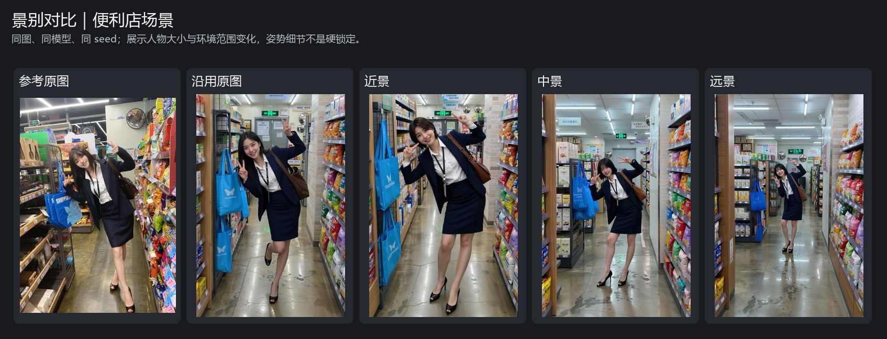
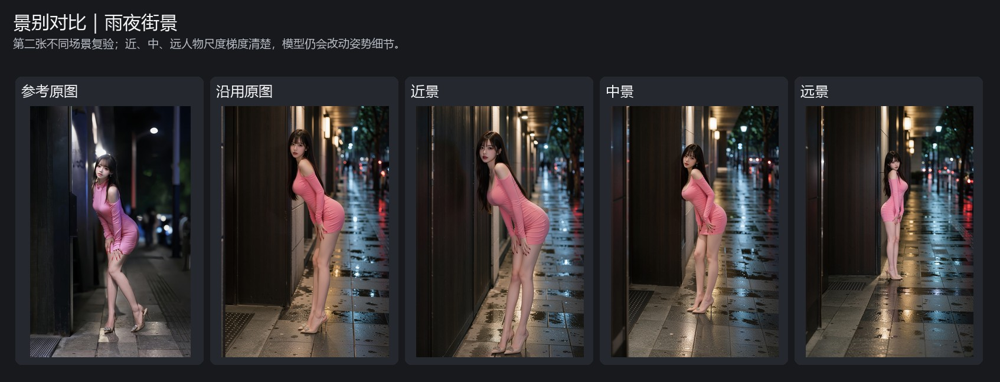
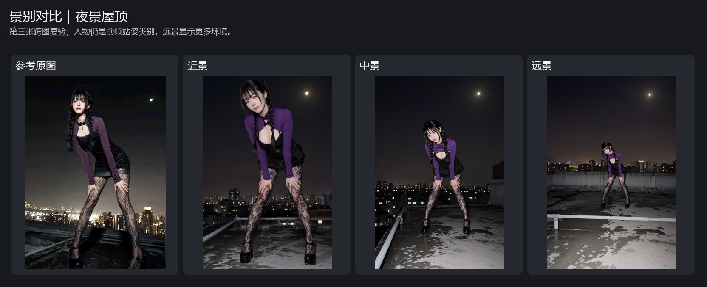
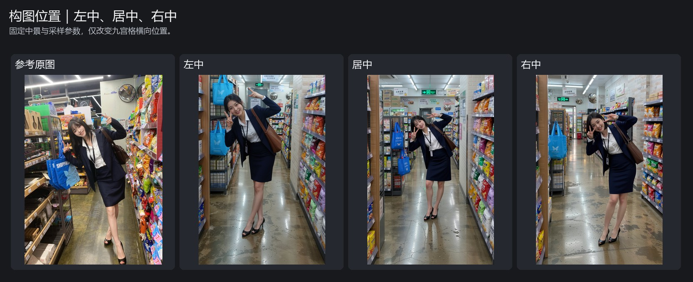
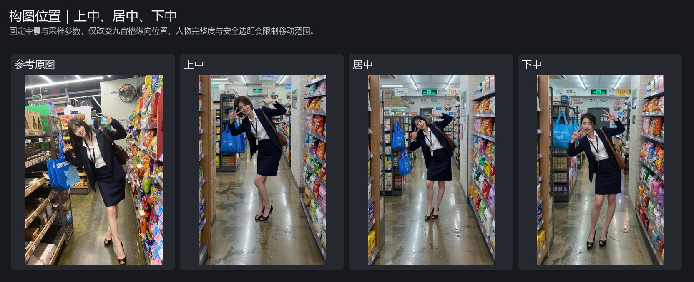

# Yeban MOSS BBox Shot Control V1

[中文](README.md) · [English](README.en.md)

Create a MOSS BBox layout prompt from a reference image, then adjust the subject's approximate size and placement with the shot-size and composition controls. The node also returns a separate smart reverse prompt for ordinary positive-prompt or restoration workflows.

This is a Windows-only ComfyUI custom-node package. It does not bundle SAM, MOSS, or vision models, and it does not install or sign in to backend clients for you.

## Update · 0.1.1 · 2026-11-12

**MOSS BBox is updated, with a focus on composition control.**

The example workflow has been updated and sampling settings adjusted. In our tests, MOSS Turbo was easier to guide with composition instructions than the original SFT model. Results may vary with the model and workflow settings.

- **Resume Grok and official DSH conversations**: check the session status and clear a session when needed, with less repeated setup.
- **Connect a local Llama vision model**: the model must support image input and have the required vision bridge configured.
- **Try the updated example workflow**: replace the sample image with your own, then tune settings for your model.
- Also fixed Chinese/English UI labels and model-option refresh.

## Install

After publication, install **Yeban MOSS BBox Shot Control V1** from ComfyUI Manager/Registry, or download this repository and place it under `ComfyUI/custom_nodes/`. Restart ComfyUI after installation.

## Prepare the SAM detector

Download `sam3.1_multiplex_fp16.safetensors` and put it in `ComfyUI/models/checkpoints/` or another registered `checkpoints` directory. The node searches registered directories, including their subfolders.

- [Download SAM 3.1 weights (about 1.75 GB)](https://huggingface.co/Comfy-Org/sam3.1/resolve/main/checkpoints/sam3.1_multiplex_fp16.safetensors)
- [Model details and license](https://huggingface.co/Comfy-Org/sam3.1)
- SHA-256: `9ba99c92703c2e8b4f47de2d34a539bb8e18923049e238b780d70dbe6368eb03`
- Baidu Netdisk mirror: https://pan.baidu.com/s/1EMgLhpDgDjHHvhitZGHGjA?pwd=rdtd

The model weights are not distributed with this plugin. Review the upstream SAM License before downloading or using them.

## Run the example workflow

Open [`examples/Yeban-MOSS-BBox-Shot-Control-V1.json`](examples/Yeban-MOSS-BBox-Shot-Control-V1.json) and select your own image in the Load Image node. The workflow does not include the reference image, SAM weights, MOSS models, or backend credentials.

Choose a vision backend in the main node, refresh its model options, and run the workflow. The first analysis calls the selected vision backend. With caching enabled, changing only shot size or composition reuses the image analysis.

### Connect the node outputs

| Output | Connect to | Purpose |
| --- | --- | --- |
| **MOSS layout prompt** | MOSS Image layout-prompt input | Supplies the layout and scene description |
| **Sampling width** | Empty Latent width | Sets the generated canvas width |
| **Sampling height** | Empty Latent height | Sets the generated canvas height |
| **Smart reverse prompt** | Optional ordinary positive-prompt workflow | Provides a separate description of visible source-image facts |

Connect the reference image to the node's **Reference Image** input. For DSH or an OpenAI-compatible API, connect the matching configuration node as well.

## Shot size and composition

Shot-size controls provide approximate target subject height. The image model can vary from the requested framing.

| Option | Approximate subject height |
| --- | ---: |
| Use reference | Preserve the source subject scale and placement as closely as possible |
| Close | About 90% of the canvas height |
| Medium | About 58% |
| Wide | About 34% |

The nine-position selector adjusts the subject group in the frame. It is disabled for **Use reference**. Safety margins and full-figure constraints can limit movement. Sampling aspect ratio and long edge determine the dimensions returned by the node; connect both dimensions to Empty Latent. Set the long edge to `0` to use the source dimensions.

## Effect examples

These are real output comparisons from feature tests. They show prompt-guided framing tendencies, not pixel-locked control; pose, identity, clothing, and exact subject scale can still vary by model and workflow.

### Shot size







### Composition position





## Configure a backend

Each user must install and sign in to their chosen service on their own Windows account. The node does not create accounts, transfer subscriptions, or install third-party clients.

### Local Grok CLI

1. Install and sign in following the [official Grok Build for Windows guide](https://docs.x.ai/build/overview).
2. Check availability in PowerShell:

   ```powershell
   grok --version
   grok models
   ```

3. Select **Local Grok CLI** in the node and use **Refresh model options**.

Conversation reuse is supported for this backend. The node keeps a bounded session per node and model; turn it off or clear the session from the node when needed.

### Local Codex CLI

1. Install and sign in using the [official Codex CLI guide](https://developers.openai.com/codex/cli).
2. Check availability in PowerShell with `codex --version`.
3. Select **Local Codex CLI** and refresh the model options.

Local Codex CLI runs the client on your computer, but requests are processed by the service associated with its account; this is not offline inference.

### Official DSH desktop app

1. Install and sign in to the **official DeepSeek Harness desktop app**, then configure an available provider and model in that app.
2. Add the **Yeban MOSS BBox Official DSH Config** node and select a provider, model, and optional conversation branch.
3. Connect its output to the main node's **DSH Config** input, then select **Official DSH** in the main node.

Conversation reuse is supported. The node follows the configured DSH account and conversation settings.

### OpenAI-compatible API

1. Add the **Yeban MOSS BBox Provider Manager** node and enter your endpoint, model, and API key.
2. Connect its output to the main node's **Provider Config** input.
3. Select **Provider API** and refresh model options.

API keys are encrypted with Windows DPAPI and bound to the current Windows user. Reconfigure the key after moving to another computer or Windows account.

### Local Llama model

Connect a compatible `LLAMACPPMODEL` and, optionally, `LLAMACPPARAMS` to the corresponding inputs, then select **Local Llama-cpp**. This backend uses the existing local Llama reverse-prompt bridge available from the companion `ComfyUI-SkillReversePrompt` custom-node package. The model itself remains local; confirm that the connected model supports image input and has a matching vision projector/handler.

## Troubleshooting

**The model list is empty**

Confirm the selected CLI or official DSH app is installed and signed in, then click **Refresh model options**. If a CLI is not on `PATH`, configure its executable path and restart ComfyUI.

**The SAM detector is not found**

Check that the filename is exactly `sam3.1_multiplex_fp16.safetensors` and that it is inside a registered `checkpoints` directory. The node does not scan arbitrary unregistered disk paths.

**Changing shot size or composition still takes a long time**

Enable caching and keep the cache seed unchanged. Caching reuses image analysis; the first analysis still calls the selected vision backend.

## Privacy and licenses

- SAM person and prop detection runs locally. The reference image is sent to the selected vision backend for analysis; choose a backend according to its privacy policy.
- The plugin does not bundle model weights, API credentials, CLI programs, or desktop clients.
- Plugin code is licensed under MIT. SAM weights, MOSS models, vendor services, and client applications follow their own licenses and terms.
