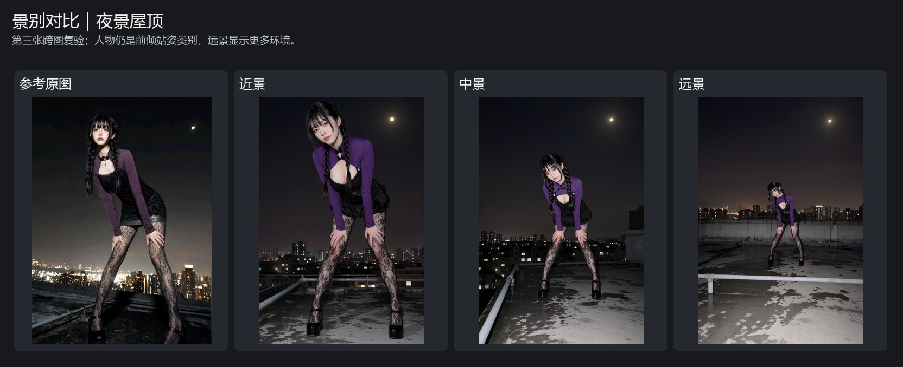

# Yeban MOSS BBox 景别控制 V1

面向 Windows 的 ComfyUI 自定义节点，用于控制 MOSS BBox 生成中的人物景别和构图位置。

> **仅面向 Windows 用户。** API 密钥使用 Windows DPAPI 加密保存；本机 Grok/Codex CLI 和官方 DSH 桌面后端也按 Windows 环境设计。本插件不会下载或捆绑第三方模型、CLI 或密钥。

## 安装

发布到 ComfyUI Registry 后，可通过 ComfyUI Manager 安装。也可以手动下载本仓库，将整个文件夹放入 ComfyUI 的 `custom_nodes` 目录，再重启 ComfyUI。建议文件夹名使用 `Yeban_MOSS_BBox`。

主节点显示为 **Yeban MOSS BBox 景别控制 V1**，分类为 **Yeban/MOSS BBox**，内部节点类型 ID 为 `YebanMossBBoxShotControlV1`。开发期间更换了节点类型 ID；若旧测试工作流仍显示已移除的输入插口，请删除旧节点后，从 **Yeban/MOSS BBox** 分类重新添加新版节点。插件可以与 `Yeban_Codex_Prompt_Writer` 并存；独立节点 ID、API 路由和供应商配置均有单独命名空间。

节点中文标签包含在 `locales/zh/nodeDefs.json` 中。对于 AIGODLIKE 翻译扩展重置未翻译节点名称的情况，插件也带有前端兼容处理。

## 功能说明

节点使用 ComfyUI 内置的 SAM 3.1 检测器在本机识别人物和部分前景道具，再调用用户选定的视觉后端分析参考图，生成 MOSS BBox 布局提示词，并额外输出一条独立的智能反推提示词。启用缓存后，切换景别和构图位置会复用已完成的图像分析，无需再次调用视觉后端。

当前版本提供本机 Grok CLI、本机 Codex CLI、官方 DSH 桌面版和 OpenAI 兼容 API 后端；暂不包含本地 Llama 推理。

景别包括：

- **沿用原图**：尽量保留参考图人物大小和位置。
- **近景**：人物目标高度约为画面高度的 90%。
- **中景**：人物目标高度约为画面高度的 58%。
- **远景**：人物目标高度约为画面高度的 34%。

九宫格用于选择非“沿用原图”时的人物组位置。这些数值是提示词布局目标，不是像素级锁定；最终画面仍会受图像模型影响。

## 效果示意

以下为 V1 的真实采样对照。景别对照使用同一参考图、固定 MOSS 模型和 seed；构图位置对照展示横向或纵向位置变化。效果用于说明提示词引导的实际变化，不代表人物姿势、身份或服装可以像素级锁定。不同模型、seed 和工作流可能产生差异。

### 景别对照




### 九宫格构图位置对照


## 示例工作流

发布包提供完整的 [Yeban MOSS BBox 景别控制 V1 示例工作流](examples/Yeban-MOSS-BBox-Shot-Control-V1.json)。工作流演示如何将布局提示词接入 MOSS Image，并将节点输出的宽、高接入空 Latent。

打开工作流后，在“加载图像”节点上传自己的参考图。示例不包含个人参考图、SAM 权重、MOSS 模型文件或 API 凭据。

## Windows 后端首次配置

插件不会替用户安装 CLI、登录账号或转移订阅。每位用户都需要在自己的 Windows 账户下安装并登录所选后端；工作流文件不保存这些登录凭据。`本机 Grok CLI` 和 `本机 Codex CLI` 是本地启动的命令行客户端，图像会由对应客户端连接的服务处理，并按用户账户的服务规则计量；这不等于离线推理。

### 本机 Grok CLI

1. 按 [Grok Build 官方 Windows 安装说明](https://docs.x.ai/build/overview)安装，并在 Grok Build 中完成登录。节点通过 Grok Build 的 CLI/ACP 接口调用模型。
2. 在同一 Windows 账户的 PowerShell 中运行以下命令，确认 CLI 可用并已列出模型：

   ```powershell
   grok --version
   grok models
   ```

3. 在主节点的“后端”中选择“本机 Grok CLI”。模型列表由 CLI 动态读取；需要重新读取时，点击“刷新模型选项”。
4. 插件会查找 PATH 中的 `grok`、`grok.exe`、`grok.cmd`，以及 `%USERPROFILE%\.grok\bin`。若 CLI 安装在自定义位置，可为运行 ComfyUI 的 Windows 用户设置 `GROK_EXECUTABLE` 或 `GROK_BIN` 环境变量，值设为 CLI 完整路径，然后重启 ComfyUI。

### 本机 Codex CLI

1. 按 [OpenAI Codex CLI 官方说明](https://developers.openai.com/codex/cli)安装，并在 CLI 中使用自己的账户完成登录。
2. 在同一 Windows 账户的 PowerShell 中运行以下命令，确认 CLI 可用：

   ```powershell
   codex --version
   ```

3. 在主节点的“后端”中选择“本机 Codex CLI”，点击“刷新模型选项”读取 CLI 提供的模型和推理强度。
4. 插件会先查找 PATH。若 CLI 使用自定义路径，可设置 `CODEX_EXECUTABLE` 或 `CODEX_BIN` 为可执行文件完整路径。改动 PATH 或环境变量后，请重启 ComfyUI。

### 官方 DSH 桌面版

1. 安装官方 DeepSeek Harness 桌面版（不是第三方桌面客户端），在桌面版中登录并配置可用的供应商和模型。
2. 在工作流中加入 **夜半 MOSS BBox 官方 DSH 配置** 节点。点击节点的选项刷新，选择官方桌面版中已配置的供应商、模型和可选对话分支。
3. 将辅助节点的“官方 DSH 配置”输出连接到主节点的“DSH 配置”输入，然后在主节点“后端”中选择“官方 DSH（本机 SDK）”。节点沿用官方桌面版的登录和供应商配置，不需要在工作流中另填 API 密钥。
4. 默认程序目录为 `%LOCALAPPDATA%\Programs\DeepSeek Harness`，默认配置目录为 `%USERPROFILE%\.dsh`。如果使用自定义目录，可设置 `DSH_OFFICIAL_INSTALL` 和 `DSH_OFFICIAL_HOME` 环境变量，再重启 ComfyUI。

若动态模型列表为空，请先确认 CLI/桌面版已安装并完成登录，再刷新选项。账号权限、订阅或 API 额度、网络可用性由用户自己的服务账户决定。

### 其他后端

- **OpenAI 兼容接口**：添加“夜半 MOSS BBox 供应商管理器”节点，填写兼容接口地址、模型和自己的 API 密钥，将供应商配置输出接到主节点。密钥由 Windows DPAPI 加密，限定当前 Windows 用户账户使用，不能直接迁移到其他电脑或账户。

## 依赖与模型

- Windows，以及提供 `comfy_api.latest` 和 `comfy_extras.nodes_sam3` 的 ComfyUI 版本。
- SAM 权重文件 `sam3.1_multiplex_fp16.safetensors`。建议放在 `ComfyUI/models/checkpoints/`。节点会在 ComfyUI 注册的 `checkpoints` 路径（含子目录及 `extra_model_paths.yaml` 配置的路径）中搜索，不会扫描无关磁盘。
- SAM 文件约 1.75 GB：[官方 Hugging Face 下载](https://huggingface.co/Comfy-Org/sam3.1/resolve/main/checkpoints/sam3.1_multiplex_fp16.safetensors)，[模型页面与许可](https://huggingface.co/Comfy-Org/sam3.1)。SHA-256：`9ba99c92703c2e8b4f47de2d34a539bb8e18923049e238b780d70dbe6368eb03`。请遵守模型页面列出的 SAM License。权重不随插件发布。
- MOSS Image 模型、选定的视觉后端及其 CLI/桌面客户端需由用户单独准备。本插件不包含模型权重、API 凭据或第三方 CLI 程序。

## 隐私与数据处理

SAM 人物和道具检测在本地运行。参考图会发送到用户在节点中选定的视觉后端进行分析：本机 Grok/Codex CLI 会按各自账号连接对应服务；官方 DSH 后端使用官方桌面版配置；兼容 API 后端连接用户填写的服务。请根据自己的隐私要求选择后端。

## 许可证

本插件代码采用 MIT License。SAM 权重、MOSS 模型、供应商服务及 CLI/桌面客户端遵循各自的许可和服务条款。
